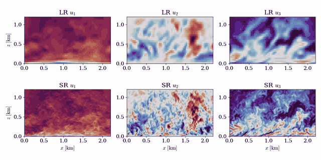
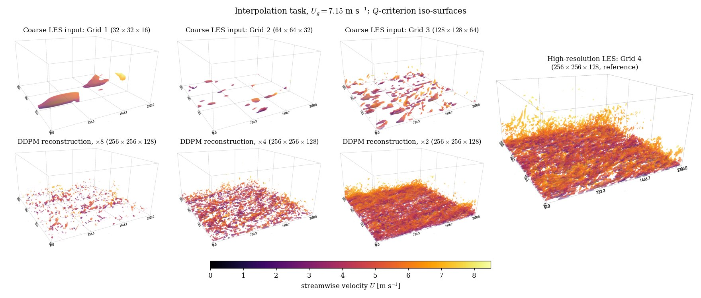
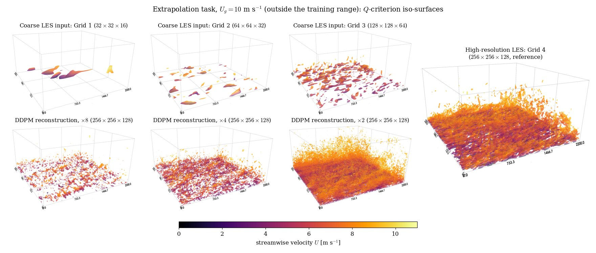
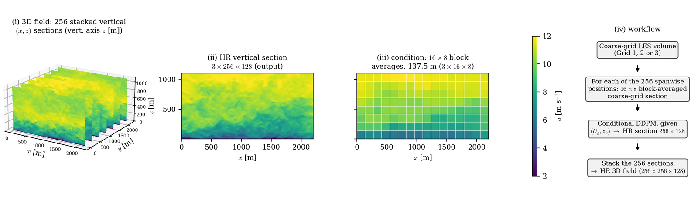
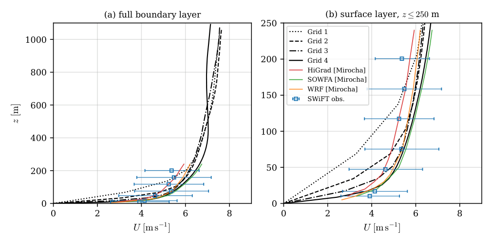
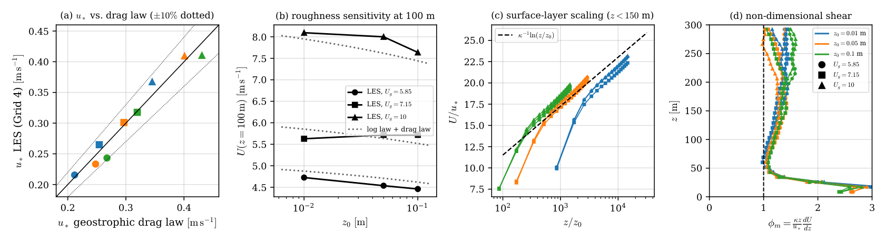

# Supervised conditional diffusion model for super-resolution of ABL large-eddy simulations


Model code and LES input files accompanying the manuscript

> O. Sallam, M. Fürth, *Supervised conditional denoising diffusion probabilistic model for
> super-resolution of atmospheric boundary layer large eddy simulation*,
> Computers & Fluids (under review, CAF-D-26-00861).

A conditional denoising diffusion probabilistic model (DDPM) reconstructs high-resolution
(256 × 256 × 128) neutral atmospheric boundary layer (ABL) velocity fields from
**genuinely coarse-grid LES**: independent simulations on 2×, 4× and 8× coarser grids,
**not** filtered or downsampled high-resolution data. The model is conditioned on the
geostrophic wind speed `U_g` and the surface roughness length `z_0`. It is trained on the
three velocity components of vertical (x, z) sections, and the 3D field is assembled
section by section.

<p align="center">
  
</p>
<p align="center"><em>Vertical section through the ABL (U<sub>g</sub> = 5.85 m/s,
z<sub>0</sub> = 0.05 m, an unseen case, ×4). Top: coarse-grid LES input. Bottom: DDPM
super-resolution. Columns: u<sub>1</sub>, u<sub>2</sub>, u<sub>3</sub>.</em></p>

## Results at a glance

### Coherent structures: Q-criterion iso-surfaces

Interpolation task. U<sub>g</sub> = 7.15 m/s lies between the training wind speeds. Top
row: coarse LES inputs. Bottom row: DDPM reconstructions for scale factors ×8, ×4 and ×2.
Right: high-resolution LES reference.



Extrapolation task. U<sub>g</sub> = 10 m/s lies 40 % above the largest training wind
speed. The reconstructions become noisy and over-energetic. As discussed in the paper, this
reflects the limited diversity of the training data (two values per physical parameter)
rather than a limitation of the architecture.



### Method: section-by-section reconstruction



### LES validation

The mean wind speed profile on four grids is compared with the LES of Mirocha et al. (2018)
(HiGrad, SOWFA, WRF) and with the SWiFT tower measurements:

<p align="center"></p>

Consistency with similarity theory:
- (a) friction velocity against the geostrophic drag law;
- (b) weak sensitivity of U(100 m) to z<sub>0</sub>;
- (c) logarithmic-law collapse;
- (d) non-dimensional shear φ<sub>m</sub>.



## Repository layout

| Folder | Content |
|---|---|
| `les/` | Xcompact3d input files (`input.i3d`) and job scripts for all cases: `U_g` = 5.85, 7.15, 10 m/s; `z_0` = 0.01, 0.05, 0.1 (and 0.2) m; folders `grid0`–`grid3` (Grids 1–4 in the paper). `rossby.py`: geostrophic drag law used to set `ustar` and `dBL`. |
| `model/` | Conditional DDPM: `train.py`, `config.yaml`, `dataset_abl_planar.py`, `utils.py`, and the modified U-Net / diffusion code in `denoising_diffusion_pytorch_modified/` (MIT, derived from lucidrains/denoising-diffusion-pytorch). |
| `docs/figures/` | Figures shown in this README. |

## LES setup (Xcompact3d)

| | |
|---|---|
| Domain | 2200 × 2200 × 1100 m, uniform isotropic grids |
| Grids | 32×32×16, 64×64×32, 128×128×64, 256×256×128 |
| Forcing | geostrophic wind with Coriolis (f = 10⁻⁴ s⁻¹), periodic horizontal boundaries, free-slip top |
| Wall model | equilibrium rough-wall log law, velocity sampled at 3Δz (`dsampling = 3`) |
| SGS model | Smagorinsky, C<sub>s</sub> = 0.14, Mason–Thomson wall damping |
| Numerics | 6th-order compact schemes, AB3 time integration |
| Run length / output | 80 000 s; 3D fields every 400 s |

The raw LES fields are not included because of their size. The job scripts use
`/path/to/project/...` and `<allocation>` placeholders. Adapt these to your HPC system.

## Model

| | |
|---|---|
| Sample | vertical (x, z) section, 3 × 256 × 128 (u, v, w), z-score normalized |
| Condition | 3 × 16 × 8 block averages of the coarse-grid section (137.5 m blocks) + (z<sub>0</sub>, U<sub>g</sub>) + diffusion step |
| Network | U-Net, 64/128/256/512 channels, residual blocks with FiLM conditioning, gated linear attention; 35.7 M parameters |
| Diffusion | v-parameterization, sigmoid noise schedule, T = 500, ancestral sampling |
| Loss | paired v-loss (block averages of the HR section) + small (~10⁻³) KL term using the genuine coarse-grid LES |
| Training | Adam, lr 10⁻⁴, batch size 16, 50 epochs, mixed precision, one H100 GPU; separate model per task and scale factor |

```bash
pip install -r requirements.txt
cd model
python train.py --config config.yaml
```

> **Note:** the included data loader (`dataset_abl_planar.py`) and `config.yaml`
> (`size: [256, 256]`) are a horizontal-plane variant (3 × 256 × 256 planes,
> 3 × 16 × 16 condition) of the same model. The loader for the vertical sections used in
> the paper is not part of this release.

Before training:
- Set `data.paths_hr` / `data.paths_lr` in `config.yaml` to the Xcompact3d `data/` folders.
- Set `data.scale_factor` to 2, 4 or 8.
- Training uses output frames 101–198.
- Provide `model/datasets_stats/abl_stats.pkl`. It is a nested dict
  `stats[U_g][z_0][coarse_grid] = {'mean': [3], 'std': [3]}` of per-component velocity
  statistics used for normalization. It is not part of this release.
- Weights & Biases logging is off by default. If you enable it, the key is read from the
  `WANDB_API_KEY` environment variable.

## Not included

- Raw LES fields, trained model weights, and the generated predictions, because of their size.
  The LES fields can be regenerated with the input files in `les/`.
- Post-processing scripts.
- The inference script that generated the predictions. Samples are drawn with
  `ConditionalGaussianDiffusion.sample(batch_size, cond, physics_cond)` section by section,
  and the 256 sections are stacked into 3D fields.
- `model/datasets_stats/abl_stats.pkl` (see *Model*).

## Citation

If you use this code, please cite the paper (the reference will be updated on publication):

```bibtex
@article{sallam_ddpm_abl_sr,
  title   = {Supervised conditional denoising diffusion probabilistic model for super-resolution
             of atmospheric boundary layer large eddy simulation},
  author  = {Sallam, Omar and F{\"u}rth, Mirjam},
  journal = {Computers \& Fluids},
  note    = {Under review},
  year    = {2026}
}
```

## License and third-party material

The code in this repository is released under the MIT License (see `LICENSE`).
The modified diffusion code in `model/denoising_diffusion_pytorch_modified/` keeps its
original MIT license (Copyright (c) 2020 Phil Wang). The reference curves in the LES
validation figure are digitized from Mirocha et al. (2018), CC BY 4.0. See `THIRD_PARTY_NOTICES.md`.
